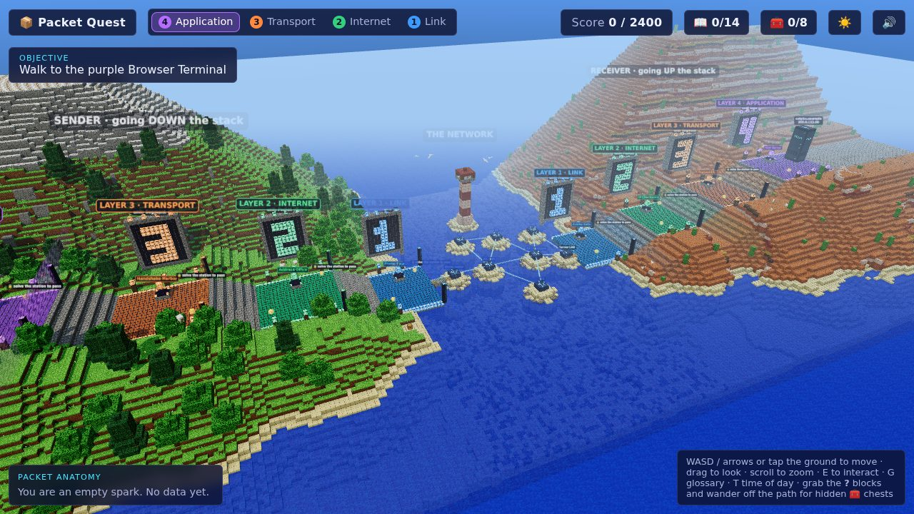

# 📦 Packet Quest



A 3D serious game, built with [Three.js](https://threejs.org), that teaches the **TCP/IP stack** by making you the packet.

Alice wants a cat picture from `catpics.example`. You are her HTTPS request:

1. **Down the sender's stack.** Walk down four plateaus, one per layer. At each station you answer questions and get wrapped in that layer's header (encapsulation).
   - **Application** · DNS lookup, choosing HTTPS on port 443
   - **Transport** · the TCP three-way handshake, ACK numbers, segmentation by MSS
   - **Internet** · IP addressing, TTL, "is the destination on my subnet?"
   - **Link** · ARP, next-hop MAC addresses, the frame checksum
2. **Across the network.** Fly as bits from router to router. At each router you pick the next hop from its routing table (longest prefix match), watch the TTL drop, the frame get rebuilt, and NAT rewrite the source address. Halfway, a congested link **drops** you: work out how TCP detects the loss, what the retransmitted copy looks like and why TCP then slows down.
3. **Up the receiver's stack.** Climb back up while each layer checks and strips its header (decapsulation): accept the right frame, verify TTL, get past the server's firewall (first matching rule wins), check the protocol field, reassemble TCP segments by sequence number and deliver to the right port.

The **Packet anatomy** panel shows your current headers and their fields at all times. Correct first answers are worth 100 points, with fewer points for later tries and an explanation for every wrong answer.

### The block world

The whole TCP/IP stack is one voxel landscape, generated in the browser from about 130,000 block faces with pixel-art textures painted at startup (no image files):

- **Sender highlands.** Alice's side is a green, forested mountain. The four layers are terraces with block staircases between them, each with a giant glowing layer number behind it.
- **The sea of routers.** The network is an ocean. Every router sits on its own sand island, linked by glowing fiber cables, with a lighthouse and circling gulls.
- **Receiver mesa.** The server's side is a red mesa with striped terracotta cliffs and cacti.
- **Exploring.** You can leave the paved path and wander the hills (up to two blocks at a time, `Space` to hop higher). 8 treasure chests hidden off the path each hold a networking fun fact. Sheep and chickens roam the terraces.
- **Day, sunset and night.** Press `T` (or the ☀️ button) to change the time of day: the sky, lighting, fog and lighthouse beam all follow.

### Extras

- **Knowledge orbs.** 14 glowing `?` orbs are hidden on the plateaus. Walk through one to unlock a glossary card (DNS, TLS, UDP, flow control, IPv6, ICMP, switches, Wi-Fi, MTU, private addresses, traceroute, sockets, QUIC, HTTP status codes). Open the glossary with `G` or the 📖 button.
- **Learning report.** The end screen lists every topic you practised, marks the ones that took more than one try as "worth another look", and remembers your best score.
- **Router Rush.** A 60-second bonus game from the start or end screen: random routing tables, one destination, pick the winning row. Streaks multiply your points, wrong answers cost 5 seconds and the tables get harder every 5 correct answers.
- **Sound.** Synthesized with the Web Audio API (no audio files). Toggle with the 🔊 button.

## Controls

| Action | Keyboard / mouse | Touch |
| --- | --- | --- |
| Move | `W` `A` `S` `D` or arrow keys, or click the ground | Tap the ground |
| Look around | Drag | Drag |
| Zoom | Scroll wheel | |
| Use a station | `E` / `Enter`, or click it | Tap the prompt |
| Glossary | `G` (close with `Esc`) | Tap 📖 |
| Hop up a ledge | `Space` | |
| Time of day | `T` | Tap ☀️ |

## Development

```bash
npm install
npm run dev      # local dev server
npm test         # unit tests for the networking logic and the lesson content
npm run build    # static build in dist/
```

## Project layout

| File | What it holds |
| --- | --- |
| `src/content.js` | The whole lesson: network constants, routing tables and every station's steps. Edit this to change or translate questions. |
| `src/logic/net.js` | Pure helpers (CIDR matching, longest prefix match, firewall rule matching, segmentation, TTL) used by the content and covered by tests. |
| `src/logic/rush.js` | Seeded question generator for Router Rush. |
| `src/glossary.js` | Knowledge orb cards and where they are hidden. |
| `src/secrets.js` | The hidden chests and their fun facts. |
| `src/layout.js` | Where everything sits: plateaus, stations, gates, routers. |
| `src/voxel/` | The block world: terrain generator, face-culling mesher with ambient occlusion, pixel-art textures, sky and day/night cycle, creatures. |
| `src/rush.js` | The Router Rush bonus game UI. |
| `src/sound.js` | Synthesized sound effects. |
| `src/world.js` | Builds the 3D world: terrain meshes, stations, gates, routers, cables, orbs and chests. |
| `src/packet.js` | The player avatar: the data core plus one shell per header. |
| `src/game.js` | Game loop, movement, camera, station flow and network flight. |
| `src/ui.js` | HUD, packet anatomy card and the station panel that runs the steps. |

Steps in `src/content.js` are plain data (`info`, `choice` or `order`) with optional `onEnter` / `onSolve` hooks, so adding a station is mostly writing questions.

## Deploying

The build is a static site with relative paths. `.github/workflows/pages.yml` publishes it to GitHub Pages on every push to `main` once Pages is set to "GitHub Actions" in the repository settings.
